## Back to Sets!

####  We are going to apply some of the stuff we learned about Predicate logic to learn a little more about sets!

####  (This is also a good opportunity for us to practice our predicate logic!)

## From Last Time, Some Other Useful Notation to Know

$\emptyset = \{\}$ is the empty set.

A **multiset**, also called a bag, tracks repeats, but not order.

####  Example

>$\{a,a,a,b,b,b,b,c,c,d,d,d,d,d\}$ is a multiset.

>It can also be written as $\{a:3, b:4, c:2, d:5\}$.

## Set Operations (Some old, some new)

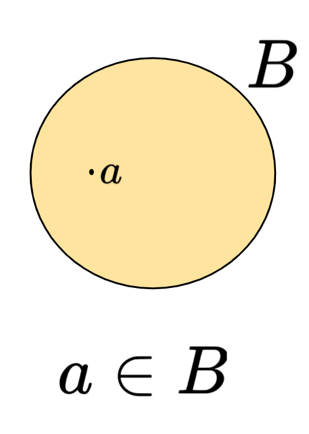

- $a \in B$ means $a$ is an element of $B$.

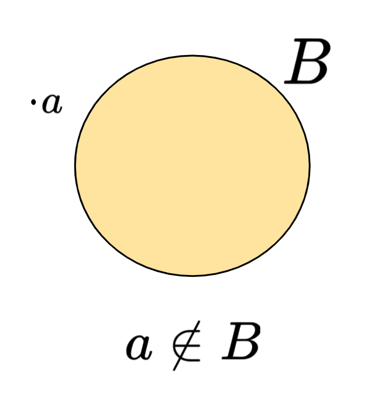

- $a \notin B$ means $a$ is *not* an element of $B$.

- Note that technically, $a \in B$ and $a \notin B$ are predicates! They take an element and a set as input and give True or False as an output.

## Subset

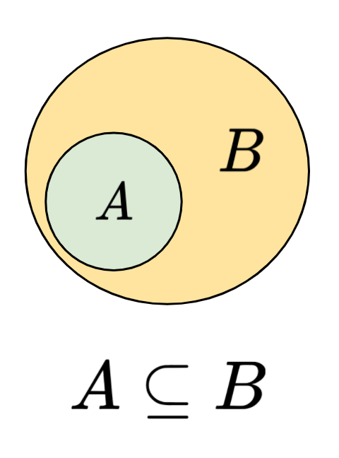

Let $A$ and $B$ be sets. We say that $A$ is a **subset** of $B$ if and only if every element of $A$ is an element of $B$.

We write $A \subseteq B$ to denote the fact that $A$ is a subset of $B$.

## Subsets Cont.

####  Using Predicate Logic

- $\forall A,B, ~ A \subseteq B \leftrightarrow \forall x \in A, ~ x \in A \rightarrow x \in B$
- Technically, we didn't define the domains for $A$ and $B$, but given the context, we know they are sets, so we'll let it slide...
- We *could* say that all sets exist in some universe of sets $S$.
- Then our quantifier would say $\forall A,B \in S \ldots$
- However, for the rest of these slides, we will just do it the lazy/easier to read way...

## Equality
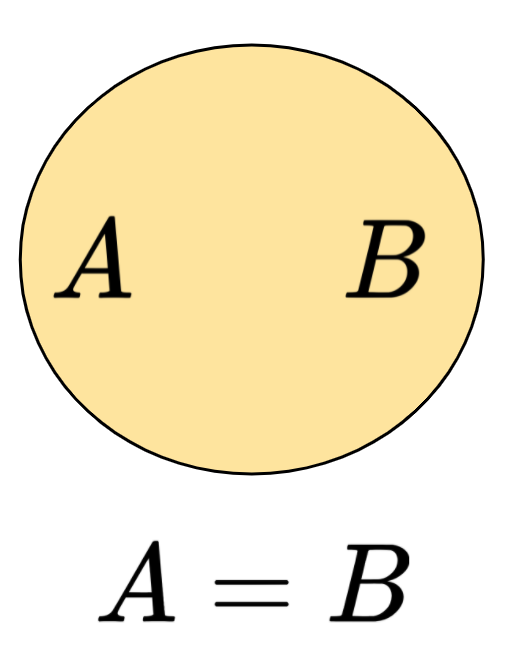

####  Using Predicate Logic

- Remember this?
- For all sets $A$ and $B$, $A = B$  if and only if every element of $A$ is an element of $B$ and every element of $B$ is an element of $A$
- $\forall A,B, ~ A = B \leftrightarrow (A \subseteq B$ and $B \subseteq A)$

## Complement

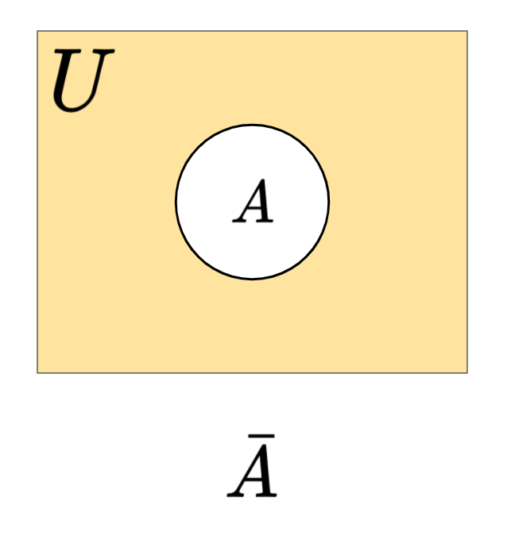

The complement of a set $A$, denoted $\bar{A}$ is the set of all elements in the universe $U$ that are *not* in $A$.

####  Using Set Notation

>$\bar{A} = \{x ~ | ~ x \notin A\}$

####  Using Predicate Logic

>$\forall a, ~ a \in \bar{A} \leftrightarrow a \notin A$

>or, equivalently, $\forall a \in U, ~ a \notin \bar{A} \leftrightarrow a \in A$

## Intersection

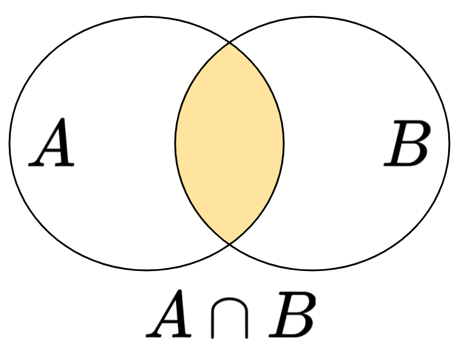

$A \cap B$ are the elements that are both in $A$ and $B$.

####  Using Set Notation

>$A \cap B = \{ x ~ | ~ x \in A \land x \in B \}$

####  Using Predicate Logic

>$\forall A, B, x, ~ x \in A \cap B \leftrightarrow (x \in A \land x \in B)$

## Union

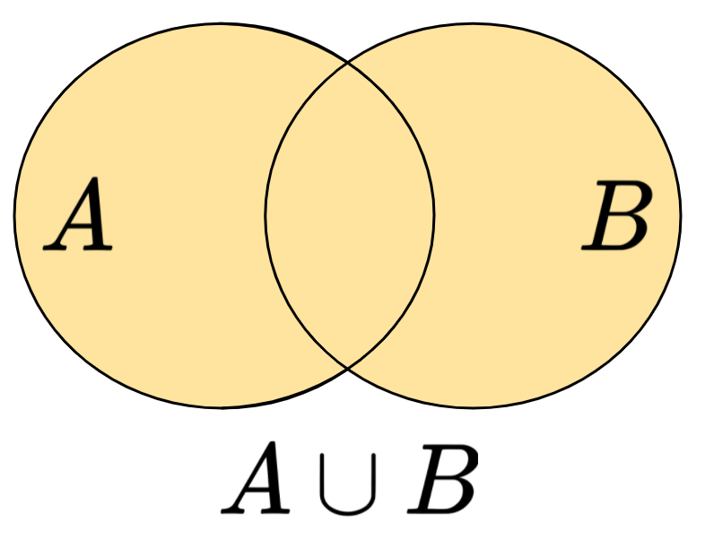

$A \cup B$ are the elements that are either in $A$ or $B$.

####  Using Set Notation

>$A \cup B = \{ x ~ | ~ x \in A \lor x \in B \}$

####  Using Predicate Logic

>$\forall A, B, x, ~ x \in A \cup B \leftrightarrow (x \in A \lor x \in B)$

## Difference

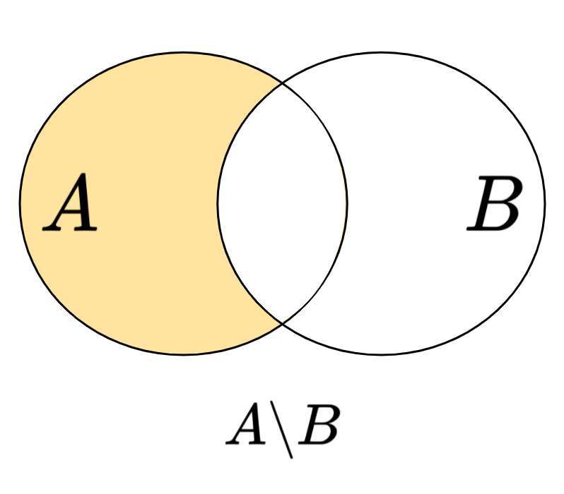

The **difference** of sets $A$ and $B$ is the set that contains all elements in $A$ that are not in $B$.

####  Using Set Notation

>$A - B = A\backslash B =\{\, x ~ | ~ x \in A \land x \notin B \}$

####  Using Predicate Logic

>$\forall A, B, x, ~ x \in A \backslash B \leftrightarrow x \in A \land x \notin B$

## Difference Cont.

####  Example

>Let $A=\{1,3,5,7\}$ and $B=\{4,5,6,7,8\}$.

>$A-B = \{1,3\}$.

####  Example

>Let $C=\{\bigcirc,\diamondsuit,\Box,\heartsuit\}$ and $e = \heartsuit$.

>$C-\{e\} = \{\bigcirc, \diamondsuit, \Box\}$.

## Xor

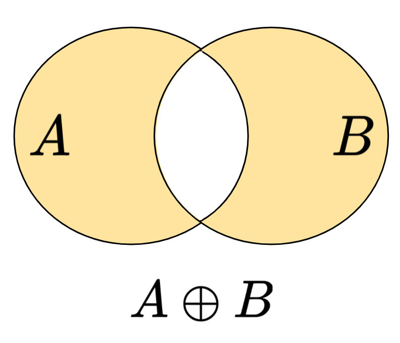

####  Using Set Notation

>$A \oplus B = \{x ~ | ~ x \in A \oplus x \in B\}$

####  Using Predicate Logic

> $\forall A,B,x, ~ x \in A \oplus B \leftrightarrow x \in A \oplus x \in B$

## Disjoint Sets

Two sets are **disjoint** if they share no elements.

>$\forall A,B,$ $A$ and $B$ are disjoint $\leftrightarrow A \cap B = \emptyset$

>$\forall A,B,$ $A$ and $B$ are disjoint $\leftrightarrow \forall x,~ (x \in B \rightarrow x \notin A) \land (x \in A \rightarrow x \notin B)$

## Disjoint Union

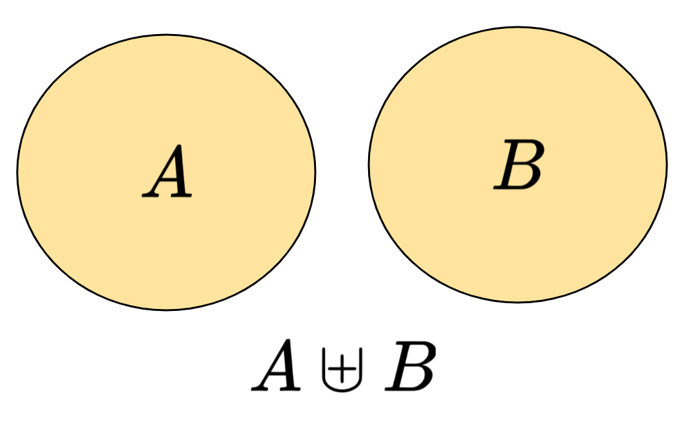

$A \uplus B$ is the union of two **disjoint** sets.

If $A$ and $B$ are disjoint (share no elements), then $A \uplus B = A \cup B$

If $A$ and $B$ share elements, then $A \uplus B = ERROR$

####  Using Predicate Logic

>$\forall A,B,~ A \uplus B = A \cup B \leftrightarrow A \cap B = \emptyset$

## Cartesian Product

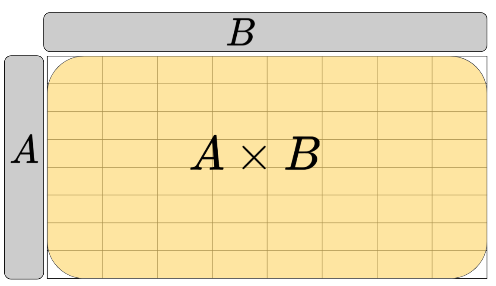

The **cartesian product** of $A$ and $B$,

####  Using Set Notation

> $A \times B = \{(a,b)| \forall a \in A$,  $\forall b \in B\}$

####  Using Predicate Logic

> $\forall A,B, a,b, ~ ((a,b) \in A \times B) \leftrightarrow (a \in A \land b \in B)$

## Powerset

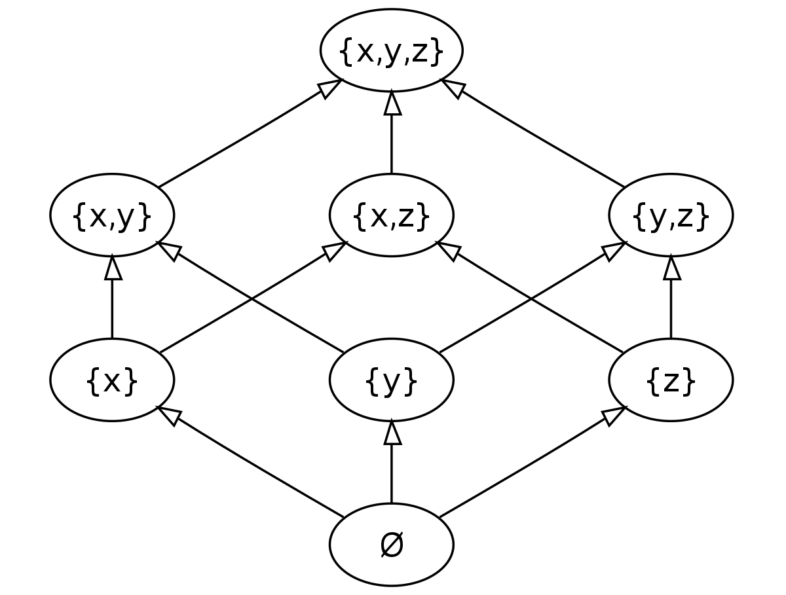

The powerset of a set $A$, denoted $\mathscr{P}(A)$ is the set of all subsets of $A$

####  Using Set Notation

>$\mathscr{P}(A) = \{ S ~ | ~ S \subseteq A\}$

- $|\mathscr{P}(A)| = 2^{|A|}$

## k-subsets

The $k$**-subsets** of a set $A$, denoted ${A \choose k}$ are all subsets of $A$ that are size $k$.

- Haven't we seen this notation before? Are we overloading operations??
- Kind of... but here's why it's okay...
- The size of ${A \choose k} = {|A| \choose k}$
