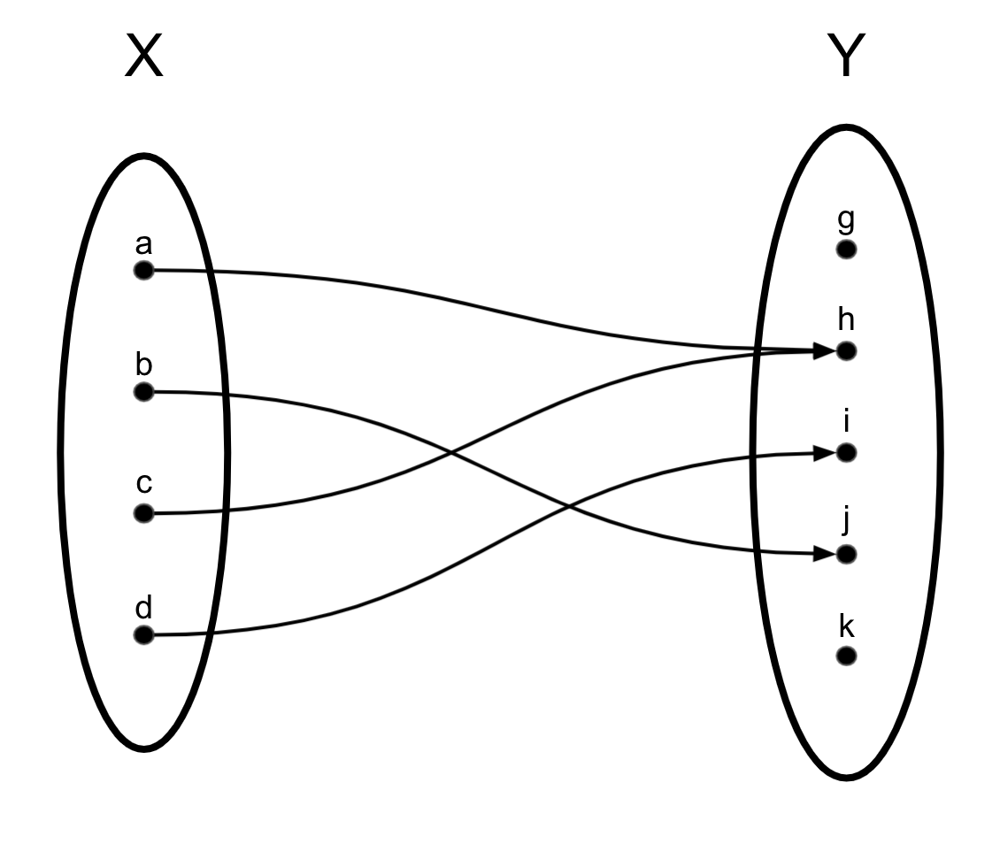
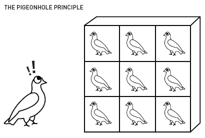
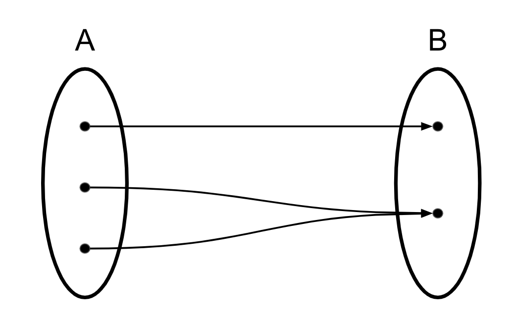

## Functions

A  **function**  $f$ is a relation on $A$ and $B$ that maps each $a$ from $A$ to exactly one element $b=f(a)$ from $B$.

You may have previously seen it as $b=f(a)$, but it also can be thought of $(a,b) \in f$.

## Functions Formalized

Let's formalize this:

A  **function**  $f$ is a relation on $A$ and $B$ that maps
each $a$ from  $A$
to exactly one element $b=f(a)$ from $B$.

$\forall a\in A$  $\exists b_1 \in B,$ $\bigl((a,b_1)\in f \bigr)$
$\land$ $\bigl(\forall b_2\in B\  ({(a,b_2)\in f} \rightarrow {b_2 = b_1}) \bigr).$

Let's break this down...

"Over $f$, each element in $A$ maps to an element in $B$."

"Over $f$, each element in $A$ maps to **exactly one** element in $B$."

## Some Things to Note...

- A function is a relation $f \subseteq A \times B$,
which we can write as  $f: A \to B$
This can be said as "$f$ maps $A$ to $B$"
- Writing $y=f(x)$ rather than   $(x,y)\in f$ makes sense if and only if $x$ pairs with only one $y$.
- $A$ is called the **domain** and $B$ is the **range**.

## Composition

For, $f: A \to B$ and $g: B \to C$,

$h = g \circ f$ is the **composition** of $g$ and $f$

which can also be written as $h(a) = g(f(a))$

Note that the output of $f$ has to be in the same set as the input for $g$!

We will demonstrate this with an example...

## Composition Example

Let's define two functions $f$ and $g$...

$f(x) = x$,  $f: \mathbb{Z} \to \mathbb{Z}$

$g(x) = \frac{1}{x}$,  $g: \mathbb{Z}^{+} \to \mathbb{Q}$

Say we define both the *domain* and *range* of $f$ as the integers

And we define the *domain* of $g$ to be $\mathbb{Z}^{+}$ (aka the positive integers)

(Note the domain can't be $\mathbb{Z}$ because  $0 \in \mathbb{Z}$, and you can't divide by zero!)

And we can define the *range* of *g* as the rational numbers, $\mathbb{Q}$, because it returns a fraction.

Can you make a composition $h = g \circ f$?

- No, because $f$ could return something that can't be input into $g$
For example,

$f(0) = 0$, and $0 \notin \mathbb{Z}^{+}$, so you can't compute $g(f(0))$

## Applying Functions to Tuples

We can apply functions to tuples.

A common example is the Pythagorean Theorem.

$$ f(x,y) = \sqrt{x^2 + y^2}$$

Note that $f: \mathbb{R} \times \mathbb{R} \to \mathbb{R}$

## Applying Functions to Sets

We can also apply functions to sets.

Say that we have $f: X \to Y$

$$f(X) = \{f(x) | x \in X \}$$

This is called the *image* of $X$ under $f$.

We can also say,

$$f^{-1}(Y) = \{ x \in X | f(x) \in Y \}$$

This is called the *pre-image* of $Y$ under $f$.

## Applying Functions to Sets - Example

- $f(\{a,b,c,d\}) = \{h, i, j\}$
- $f^{-1}(\{h,i,j\}) = \{a,b,c,d\}$
- $f^{-1}(\{g,k\}) = \{\}$

## Thinking about square roots...

Reminder: A  function  $f$ is a relation on $A$ and $B$ that maps
each $a$ from  $A$
to exactly one element $b=f(a)$ from $B$.

So, is $f(x) = \sqrt{x}$ a function?

*It depends!*

>When $A = \mathbb{R}$ and $B = \mathbb{R}$?
>

No, because $f(-1)$ gives an answer that's not in the real numbers.
($\sqrt{-1} \notin \mathbb{R}$)

>When $A = \mathbb{R}^+$ and $B = \mathbb{R}$?
>

No, because $\sqrt{4} = \pm 2$. A function must map an input to only one answer.

>When $A = \mathbb{R}^+$ and $B = \mathbb{R}^+$?
>

Yes!

## Types of Functions

Recall...

A  **function**  $f$ is a relation on $A$ and $B$ that maps each $a$ from  $A$
to exactly one element $b=f(a)$ from $B$.

$\forall a\in A\  \exists b_1\in B \bigl($  $(a,b_1)\in f$

$$
\bigr)\land \bigl(\forall b_2\in B\  ({(a,b_2)\in f} \rightarrow {b_2 =
b_1}) \bigr).
$$

Actually, the full term for this definition is a **total function**.

A  **partial function**  $f$ is a relation on $A$ and $B$ that maps each $a$ from  $A$
to *at most* one element $b=f(a)$ from $B$.

In other words, If $x \in A$, $f(x)$ doesn't *necessarily* evaluate.

>A common example of this is a computer program that only accepts certain inputs, and returns ERROR (or crashes) if it's not an acceptable input.

## Types of Functions: injection

A function $f: A \to B$ is an **injection** iff each element of $B$ is hit by at most one element in $A$.

$\forall x_1,x_2\in A, ~  \bigl(f(x_1)=f(x_2)\bigr) \rightarrow (x_1=x_2).$

Another logically equivalent way to state this is:

$\forall x_1,x_2\in A, ~   (x_1{\neq}x_2)\rightarrow \bigl(f(x_1){\ne}f(x_2)\bigr).$

This logical definition inspires the other term for an injection which is **one-to-one** because one input maps to one output.

This term doesn't quite capture the full meaning though because, by definition, all functions map one input to one output.

## Types of Functions: surjection

A function $f: A\to B$ is a **surjection**,
or  **onto**, if and only if every element of $B$ is hit by at least one element in $A$.

$\forall y \in B ~ \exists x \in A, ~   f(x)=y$.

In other words, $f(A)=B$.

## Types of Functions: bijection

A function $f: A\to B$ is a **bijection**
if and only if it is an injection and a surjection.

$$
\forall b\in B, ~  \exists a_1 \in A, ~  \bigl(f(a_1)=b
\bigr)\land \bigl(\forall_{a_2\in A}\  ({f(a_2)= b}) \rightarrow ({a_2 =
a_1}) \bigr).
$$

## Functions Practice

Practice Problem

Let $A = \{1, 2, 3\}$,

$B = \{a, b, c, d\}$, and

$f = \{(1,a),(2,a),(3,b)\}$.

Is $f$ a valid function from $A$ to $B$?

Definition:

$$
\forall a\in A\  \exists b_1\in B \bigl((a,b_1)\in f
\bigr)\land \bigl(\forall b_2\in B\  ({(a,b_2)\in f} \rightarrow {b_2 =
b_1}) \bigr).
$$

"Every element in $A$ maps to exactly one element in $B$."

Yes!

## Functions Practice

Practice Problem

Let $A = \{1, 2, 3\}$,

$B = \{a, b, c, d\}$, and

$f = \{(1,a),(2,a),(3,b)\}$.

Is $f$ injective?

Definition: $\forall x_1,x_2\in A, ~  \bigl(f(x_1)=f(x_2)\bigr) \rightarrow (x_1=x_2).$

"Each element of $B$ is hit by at most one element in $A$."

No. $f(1) = f(2) = a$

## Functions Practice

Practice Problem

Let $A = \{1, 2, 3\}$,

$B = \{a, b, c, d\}$, and

$f = \{(1,a),(2,a),(3,b)\}$.

Is $f$ surjective?

Definition: $\forall y \in B ~ \exists x \in A, ~   f(x)=y$.

"Every element of $B$ is hit by at least one element in $A$."

No- $c$ and $d$ are never hit.

## Pigeonhole Principle

The pigeonhole principle states: You can not fit $n+1$ pigeons into $n$ holes without having two pigeons share a hole.

## Pigeonhole Principle
Bringing it back to functions...

If you are mapping $f: A \to B$ and $|A|>|B|$, then there is no way to map from every element in $A$ without two of them hitting the same element in $B$.

## How we can use it...

An airport with 1,500 landings a day must be able to accommodate
two planes landing in the same minute.

- Why? There are $1440$ minutes in a day so, by the pigeonhole principle, if there are greater than $1440$ planes coming in, some planes will have to land in the same minute.

## How we can use it...

In a class of $35$ students, if a majority are women and a majority are
majoring in computer science, then at least one is both.

- Why? (Informal proof by contradiction. Start with false statement, and show that it leads to a contradiction. Aka show the negation is NOT true.)
- Let $S=$ set of all students, $M=$ set of all CS majors, $W=$  set of all women.  $M \subseteq S$ and $W \subseteq S$.
- "Majority are women" means $|W| > \frac{35}{2}$ or $|W| \geq 18$
- "Majority are majoring in computer science" means $|M| > \frac{35}{2}$ or $|M| \geq 18$
- If $M \subseteq S$ and $W \subseteq S$, then $M \cup W \subseteq S$
- If $M \cup W \subseteq S$, then $|M \cup W| \leq |S|$
- Negation: Assume no one is both a computer science major and a woman. ($M \cap W = \{\}$)
- Since $M \cap W = \{\}$, $|M \cup W| = |M| + |W| \geq 18 + 18 = 36$.
- $|M \cup W| = 36$ and $|S| = 35$, but $|M \cup W| \leq |S|$. $\rightarrow \leftarrow$

## Applying Pigeonhole Principle to Functions

- Recall: If you are mapping $f: A \to B$ and $|A|>|B|$, then there is no way to map from every element in $A$ without two of them hitting the same element in $B$.
- Injection: each element of $B$ is hit by at most one element in $A$
- So if $|A| > |B|$, by definition $f$ is not an injection. (Aka there are too many arrows coming from $A$.)
- Surjection: each element of $B$ is hit by at least one element in $A$
- So if $|A| < |B|$, by definition $f$ is not a surjection. (Aka there are not enough arrows coming from $A$.)
- From this follows: $f: A \to B$ is a bijection $\iff |A| = |B|$

## Implications of Pigeonhole Principle

- $f: A \to B$ is a bijection $\iff |A| = |B|$
- Think about what this means if $A$ and $B$ are infinite sets...
- Lets $A = \mathbb{N}$ and $B = \mathbb{Z}$
- If we can show there exists a bijection $f:  \mathbb{N} \to \mathbb{Z}$, then
$|\mathbb{N}| = |\mathbb{Z}|$!
- (We can!)
- A set is called **countably infinite** (or denumerable) if it can be put in bijective correspondence with the set of natural numbers.
- A set is called **countable** if it is either finite or countably infinite.

## Functions Practice

For this problem let

$A = \{x \mid x \in \mathbb{Z}\}$ and

$B = \{3x |x \in \mathbb{Z}\}$

Prove $A$ and $B$ have the same cardinality by defining a bijection from $A$ to $B$.

Step 1: Define a bijection.

$f: A \to B$

$f(x) = 3x$

## Functions Practice

For this problem let

$A = \{x \mid x \in \mathbb{Z}\}$ and

$B = \{3x |x \in \mathbb{Z}\}$

Prove $A$ and $B$ have the same cardinality by defining a bijection from $A$ to $B$.

Step 1: Define a bijection. $f: A \to B$, $f(x) = 3x$

Step 2: Prove  $f: A \to B$, $f(x) = 3x$ is a bijection.

Injection:

Definition: $\forall x_1,x_2\in A, ~  \bigl(f(x_1)=f(x_2)\bigr) \rightarrow (x_1=x_2).$

$$
\begin{align*}
f(x_1) &= f(x_2)\\
3 x_1 &= 3 x_2\\
x_1 &= x_2
\end{align*}
$$

## Functions Practice

For this problem let

$A = \{x \mid x \in \mathbb{R}\}$ and

$B = \{3x |x \in \mathbb{R}\}$

Prove $A$ and $B$ have the same cardinality by defining a bijection from $A$ to $B$.

Step 1: Define a bijection. $f: A \to B$, $f(x) = 3x$

Step 2: Prove  $f: A \to B$, $f(x) = 3x$ is a bijection.

Surjection:

For any $y \in B$ you can define an $x \in A$ such that $f(x) = y$.

Given $y \in \mathbb{R}$, let $x = \frac{y}{3} \in \mathbb{R}$

then $f(x) = 3\cdot\frac{y}{3} = y$.

## Measuring Size of Inputs

- Computers have size and memory limits, so it's important that we can analyze our algorithms so that we know they are something the computer can handle.
- Commonly, we use **asymptotic notation** to describe runtime.
- "Big O": $O$ is used to measure the worst case scenario of an input. (In other words, it is an upper bound.)
- $f \in O(g(n)) \iff \exists c \in \mathbb{R}^{+}, \exists N \in \mathbb{N}, \forall n < N, 0 \leq f(n) \leq c \cdot g(n)$
- $\Omega$ is used to measure the best case scenario of an input. (In other words, it is an lower bound.)
- $f \in \Omega(g(n)) \iff \exists c \in \mathbb{R}^{+}, \exists N \in \mathbb{N}, \forall n < N, 0 \leq c \cdot g(n) \leq f(n)$
- $\Theta$ is used to describe a function that is both in $O$ and $\Omega$.
- $f \in \Theta(g(n))$ $\iff \exists c_L, c_H \in \mathbb{R}^{+}, \exists N \in \mathbb{N}, \forall n < N, 0 \leq c_L \cdot g(n) \leq f(n) \leq c_H \cdot g(n)$
