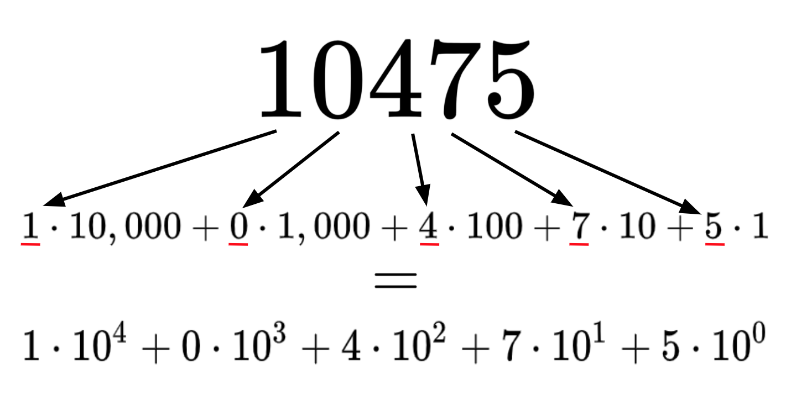
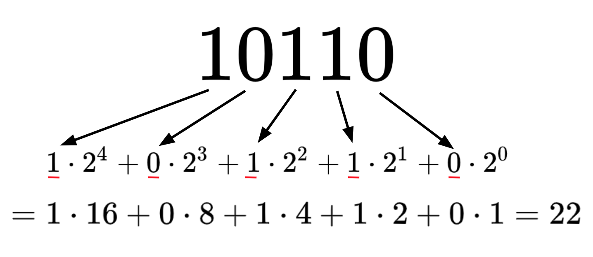

## Useful Operators - Floor and Ceiling

Floor and Ceiling are two common operators used in mathematics.

The **floor** operator, denoted $\left \lfloor{x}\right \rfloor$, tells us the greatest integer $\leq x$.

The **ceiling** operator, denoted $\left \lceil{x}\right \rceil$,  tells us the smallest integer $\geq x$.

(Basically, they're just fancy ways of saying "round down" and "round up")

### Example

- $\left \lfloor{7.5}\right \rfloor = 7$

- $\left \lceil{7.5}\right \rceil = 8$

## Property of Floor

One property can emerge from the definition of floor.

$x-1 < \left \lfloor{x}\right \rfloor$

| Statement | Reason |
| -------- | -------- |
| 1. We can write $x$ as $x = y + d$ where $y$ is an integer and $d$ is a decimal < 1. (E.g. $7.5 = 7 + .5$) |  Rewrite |
| 2. $\left \lfloor{x}\right \rfloor = y$  |  Definition of Floor |
|  3. $d-1 < 0$  |  Line 1 ($0<d<1$) |
|  4. $y + d - 1 < y$. |  Add $y$ to both sides |
|  5. $x - 1 < y$ | Plug in $x = y + d$ (Line 1) |
|  6. $x - 1 < \left \lfloor{x}\right \rfloor$ |  Plug in  $y = \left \lfloor{x}\right \rfloor$ (Line 2)  |

## Property of Ceiling

(You can prove this similarly to the way we proved the floor property!)

$x \leq \left \lceil{x}\right \rceil < x + 1$

## Bases

We usually represent numbers in base ten

## Bases

- In general, a number in the form of digits $d_k d_{k-1} \ldots d_1 d_0$ can be represented as
$\sum_{i\in[0,k]}d_i t^i = d_kt^k + d_{k-1}t^{k-1}+ \ldots + d_1t^1 + d_0t^0$
where $t$ is the base

- All digits $d_i$ are in the range $[0,t-1]$

### Example

- Let's go back to representing the number $10,475$ in base $10$
- So the digits are $d_4 = 1$, $d_3 = 0$, $d_2 = 4$, $d_1 = 7$, $d_0 = 5$ and the base is $t = 10$
- Which gives us what we got before: $10,475 = 1 \cdot 10^4 + 0 \cdot 10^3 + 4 \cdot 10^2 + 7 \cdot 10^1 + 5 \cdot 10^0$
- Also note that all digits are between $0$ and $9$.

## Base 2

- Often in computer science, we represent numbers in base $2$. This is also called "binary" representation.
- Since our base $t = 2$, then our digits are in the range $[0,1]$. So basically, we are just looking at strings of $0$s and $1$s. (Often we call $0$s and $1$s "bits". $8$ bits is a byte.)

## STOP!

### Do your CQ Assignment Before Continuing!

## Length of Binary Messages

If I want to express $x$ in binary, how long will it be?

(In other words, how many *bits* will it take?)

-  Think about the procedure we just did for converting a number to binary. We find the highest power of $2$ that is less than or equal to $x$: $k = \left \lfloor{\log_2(x)}\right \rfloor$
-  We know this means that our string of bits will be of length $k$.
-  This can be generalized for any base $b$: The length of any number $x$ in base $b$ is $\left \lfloor{\log_b(x)}\right \rfloor$

## Useful Operator - Divides

For all integers $a,b$ we can say $a$ **divides** $b$, or $a \mid b$, iff there exists some integer $m$ such that $a\cdot m = b$.

### Example

- We can say $2$ divides $6$, or $2 \mid 6$, because $2 \cdot 3 = 6$
- Notice that if $b = 0$ and $m = 0$, then $a$ can be anything. From this we conclude that every number divides $0$.
$\forall a \in \mathbb{Z}, a \mid 0$

## Useful Operator - Mod

For positive Integers, $x \bmod y$ is the remainder of $x/y$.

More generally, $x \bmod y = x - \left \lfloor{x/y}\right \rfloor \cdot y$.

### Examples

-  $5 \bmod 2 = 1$
-  $4 \bmod 2 = 0$
-  $-1 \bmod 2 = 1$
- *Note that the value of $x \bmod y$ is between $0$ and $y-1$!*

## Congruence Modulo y

Another way we can express mods is via congruency.

$x \equiv z \pmod y$ reads as "$x$ is congruent to $z$ mod $y$".

What this means is that $x \bmod y = z \bmod y$.

### Example

-  $4 \bmod 2 = 0$ and $6 \bmod 2 = 0$, so $4 \equiv 6 \pmod 2$.

## GCD + Relatively Prime Numbers

The **greatest common divisor** of two integers $x$ and $y$, denoted $GCD(x,y)$ is the largest positive integer that divides both $x$ and $y$.

### Example
- $GCD(8,12) = 4$
- $GCD(3,6) = 3$
- $GCD(4,7) = 1$

If $GCD(x,y) = 1$, then $x$ and $y$ are **relatively prime** (also called coprime).

## The Naive Approach is Slow

To find $\gcd(a, b)$ by listing divisors, we'd need to check every integer from $1$ up to $\min(a, b)$.

> For $\gcd(1{,}000{,}000{,}007,\ 998{,}244{,}353)$...

> That's nearly a billion checks.

We need something smarter.

## The Key Insight

Here's the observation that makes the Euclidean Algorithm work:

$$\gcd(a, b) = \gcd(b,\ a \bmod b)$$

> Think about this in terms of a recursive function... the right hand side has smaller arguments!

## The Euclidean Algorithm

This is a **recursive algorithm** — the same structure as everything we've studied!

We keep applying the rule $\gcd(a, b) = \gcd(b,\ a \bmod b)$ until the second number reaches $0$.

**Base case:** $\gcd(a, 0) = a$

**Recursive rule:** $\gcd(a, b) = \gcd(b,\ a \bmod b)$ for $b > 0$

## Worked Example: $\gcd(48, 18)$

Recall $\gcd(a, b) = \gcd(b,\ a \bmod b)$

$$
\begin{align*}
\gcd(48, 18) &= \gcd(18,\ 48 \bmod 18) &= \gcd(18, 12)\\
&= \gcd(12,\ 18 \bmod 12) &= \gcd(12, 6)\\
&= \gcd(6,\ 12 \bmod 6) &= \gcd(6, 0)\\
&= 6
\end{align*}
$$

## Worked Example: $\gcd(35, 13)$

Recall $\gcd(a, b) = \gcd(b,\ a \bmod b)$

$$
\begin{align*}
\gcd(35, 13) &= \gcd(13,\ 35 \bmod 13) &= \gcd(13, 9) \\
&= \gcd(9,\ 13 \bmod 9) &= \gcd(9, 4)\\
&= \gcd(4,\ 9 \bmod 4) &= \gcd(4, 1)\\
&= \gcd(1,\ 4 \bmod 1) &= \gcd(1, 0)\\
&= 1
\end{align*}
$$

When $\gcd(a, b) = 1$, we say $a$ and $b$ are **coprime** (they share no common factors other than 1).
