## Algorithms

Input is data given to an algorithm

An algorithm is a series of steps

An algorithm returns some result

An algorithm may be influenced by its environment and it may  produce side-effects which influence its environment.

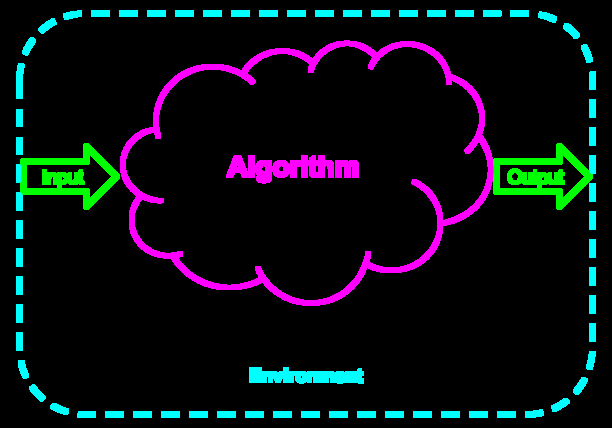

## What you will learn

- How to come up with an algorithm to solve a given problem
- How to express that algorithm in pseudocode
- What you can *say* about the algorithm (e.g. what kind of guarantees you can make about the outcome, how long it takes, etc.)

## Example: Finding the Lowest Card in a Deck

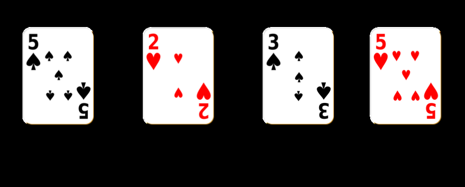

## Example: Finding the Lowest Card in a Deck

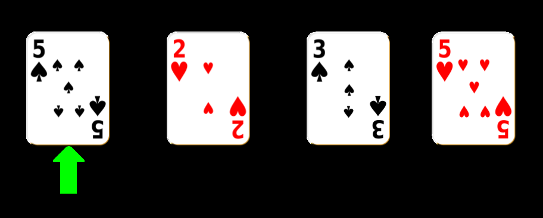

Low card: 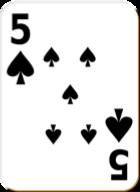

## Example: Finding the Lowest Card in a Deck


5 < 5?

Low card: 

## Example: Finding the Lowest Card in a Deck

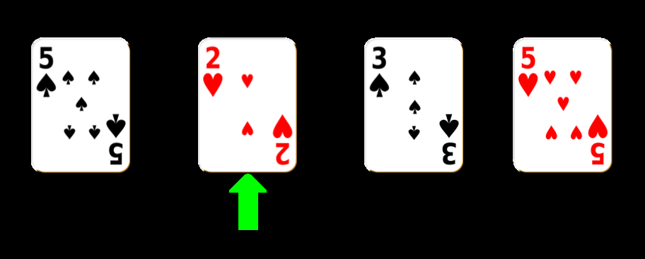

2 < 5?

Low card: 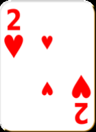

## Example: Finding the Lowest Card in a Deck

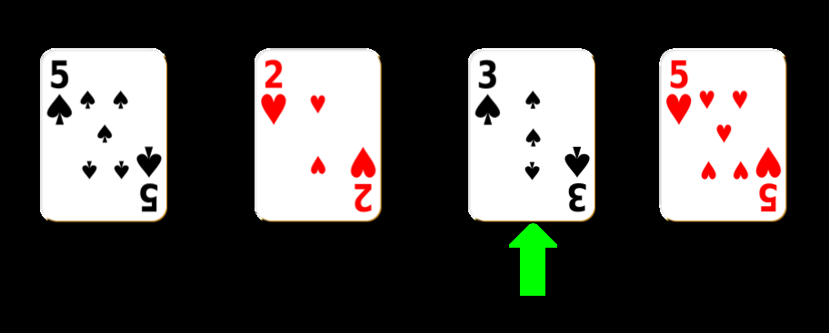

3 < 2?

Low card: 

## Example: Finding the Lowest Card in a Deck

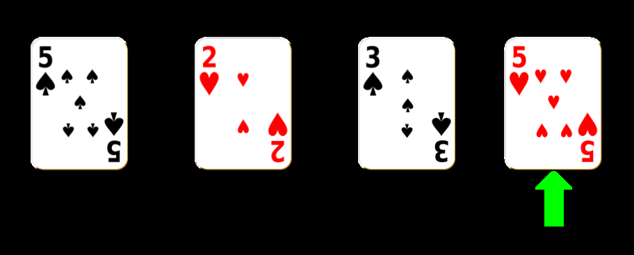

5 < 2?

Low card: 

## Pseudocode (Over a list)

Returning smallest *element*

```
INPUT my_list: list
min = my_list[0]
FOR element in my_list:
    IF element < min:
        min = element
RETURN min
```

## Pseudocode (Over a list)

Returning *index* of smallest element

```
INPUT my_list: list
n = LENGTH(my_list)
min_idx = 0
FOR index in [0,n-1]:
    IF my_list[index] < my_list[min_idx]:
        min_idx = index
RETURN min_idx
```

## Invariants

* An invariant is a statement that is true during all steps of a procedure.

* In other words, your invariant should be true at Step 0, Step 1, and Step 1000 of your algorithm.

* If the invariant holds for an arbitrary step of your algorithm, this means it'll always hold! (What does that sound like?)

* If the invariant always holds, this means that it'll hold at the last step, which tells us something about our output!

## Example

```
INPUT my_list: list
min = my_list[0]
FOR element in my_list:
    IF element < min:
        min = element
RETURN min
```

My algorithm takes as input list `A`

and outputs: `min` $\in \mathbb{Z}$

such that: $\forall$ `elem` $\in$ `A`, `min` $\leq$ `elem`

## Example

```
INPUT my_list: list
n = LENGTH(my_list)
min_idx = 0
FOR index in [0,n-1]:
    IF my_list[index] < my_list[min_idx]:
        min_idx = index
RETURN min_idx
```

My algorithm takes as input list `A`

and outputs: `min_idx` $\in [0,$ `len(A)`$-1]$

such that:

$\forall$ `j` $\in [0,$ `len(A)`$-1]$, `A[min_idx]` $\leq$ `A[j]`

## Invariants

An invariant says something about your algorithm at every step of execution, not just at output.

```
INPUT my_list: list
n = LENGTH(my_list)
min_idx = 0
FOR index in [0,n-1]:
    IF my_list[index] < my_list[min_idx]:
        min_idx = index
RETURN min_idx
```

Every time you start a new iteration in your for loop, the invariant updates.

## Invariants

```
INPUT my_list: list
n = LENGTH(my_list)
min_idx = 0
FOR index in [0,n-1]:
    IF my_list[index] < my_list[min_idx]:
        min_idx = index
RETURN min_idx
```

My algorithm takes as input list `A`

and behaves such that: $\forall i \in [0,$ `len(A)`$-1]$

there exists:  `min_idx` $\in [0,i-1]$,

such that:
$\forall$ `j` $\in [0, i-1]$, `A[min_idx]` $\leq$ `A[j]`

## Invariants

```
INPUT my_list: list
n = LENGTH(my_list)
min_idx = 0
FOR index in [0,n-1]:
    IF my_list[index] < my_list[min_idx]:
        min_idx = index
RETURN min_idx
```

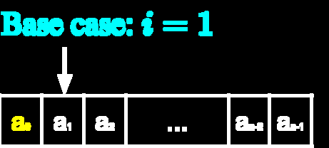

My algorithm takes as input list `A`

and behaves such that: $\forall i \in [0,$ `len(A)`$-1]$

there exists:  `min_idx` $\in [0,i-1]$,

such that:
$\forall$ `j` $\in [0, i-1]$, `A[min_idx]` $\leq$ `A[j]`

## Invariants

```
INPUT my_list: list
n = LENGTH(my_list)
min_idx = 0
FOR index in [0,n-1]:
    IF my_list[index] < my_list[min_idx]:
        min_idx = index
RETURN min_idx
```

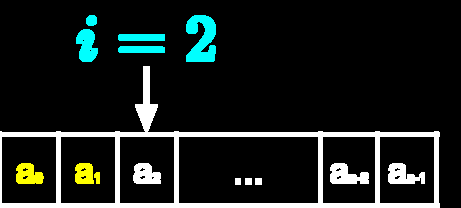

My algorithm takes as input list `A`

and behaves such that: $\forall i \in [0,$ `len(A)`$-1]$

there exists:  `min_idx` $\in [0,i-1]$,

such that:
$\forall$ `j` $\in [0, i-1]$, `A[min_idx]` $\leq$ `A[j]`

## Invariants

```
INPUT my_list: list
n = LENGTH(my_list)
min_idx = 0
FOR index in [0,n-1]:
    IF my_list[index] < my_list[min_idx]:
        min_idx = index
RETURN min_idx
```

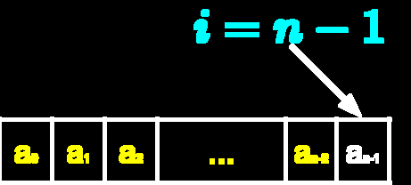

My algorithm takes as input list `A`

and behaves such that: $\forall i \in [0,$ `len(A)`$-1]$

there exists:  `min_idx` $\in [0,i-1]$,

such that:
$\forall$ `j` $\in [0, i-1]$, `A[min_idx]` $\leq$ `A[j]`

## Invariants

```
INPUT my_list: list
n = LENGTH(my_list)
min_idx = 0
FOR index in [0,n-1]:
    IF my_list[index] < my_list[min_idx]:
        min_idx = index
RETURN min_idx
```

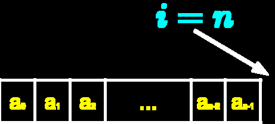

My algorithm takes as input list `A`

and behaves such that: $\forall i \in [0,$ `len(A)`$-1]$

there exists:  `min_idx` $\in [0,i-1]$,

such that:
$\forall$ `j` $\in [0, i-1]$, `A[min_idx]` $\leq$ `A[j]`
