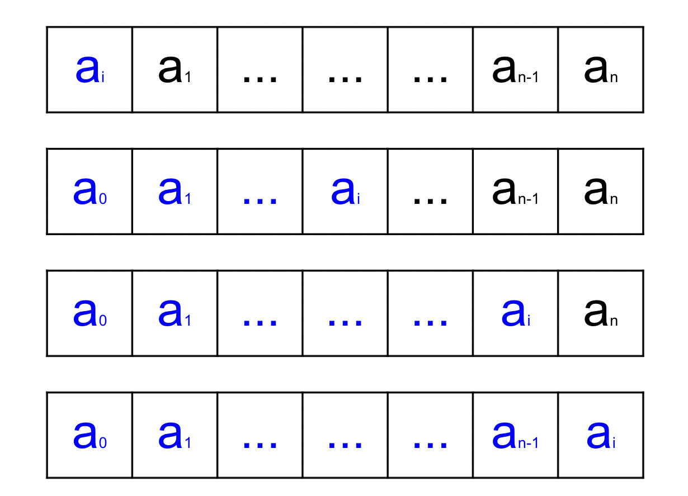
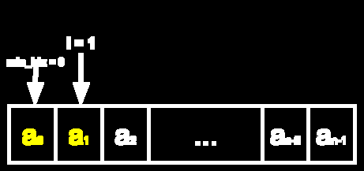
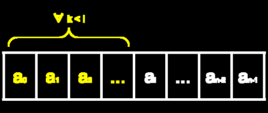
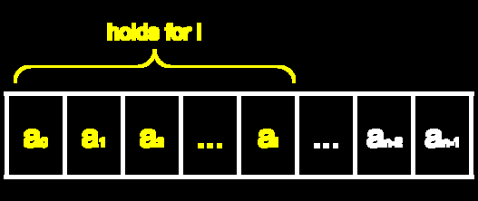

## Recall:

- An **invariant** is a statement that is true during all steps of a procedure.
- In other words, your invariant should be true at Step 0, Step 1, and Step 1000 of your algorithm.
- If the invariant holds for an arbitrary step of your algorithm, this means it'll always hold!
- If the invariant always holds, this means that it'll hold at the last step, which tells us something about our output!

## Proving our Invariant

- We've discussed that if we can prove our invariant, we can prove something about our output! So how do we prove our invariant?
- We can prove our invariant by induction!
- We are going to induct on our loop variable $\texttt{i}$ and show that for every trip through the loop our invariant holds!



## Proving our Invariant

### Step 1
We want to prove:

$\textrm{For input list } \texttt{A},$

$\forall \texttt{i} \in [0, \texttt{length(A)}],$

$\exists ~ \texttt{min\_idx} \in [0,\texttt{i} - 1],$

$\forall \texttt{j} \in [0,\texttt{i} - 1], \texttt{A[min\_idx]} \leq \texttt{A[j]}$

### Step 2

We prove this by induction on $\texttt{i}$.

## Proving our Invariant

### Step 3 (Base case)

- *Before* we enter the loop. ($\texttt{i}=1$)
- Plug in to statement we're trying to prove:
- $\exists ~ \texttt{min\_idx} \in [0,0],$
$\forall \texttt{j} \in [0,0], \texttt{A[min\_idx]} \leq \texttt{A[j]}$
- So $\texttt{min\_idx} = 0$
- Possible values for $\texttt{j}$: $0$
- $\texttt{A[0]} \leq \texttt{A[0]} \square$

```
INPUT A: list
n = LENGTH(A)
min_idx = 0
FOR index in [0,n-1]:
    IF A[index] < A[min_idx]:
        min_idx = index
RETURN min_idx
```



## Proving our Invariant

### Step 4
For a given $\texttt{i} > 1$,

### Step 5
Induction Hypothesis: I can assume, for all $\texttt{k}$,

with $1 \leq \texttt{k} < \texttt{i}$, that $\exists \texttt{min\_idx} \in [0,\texttt{k} - 1],$
$\forall \texttt{j} \in [0,\texttt{k} - 1],$
$\texttt{A[min\_idx]} \leq \texttt{A[j]}$

### Step 6
I want to prove that $\exists \texttt{min\_idx} \in [0,\texttt{i} - 1],$
and
$\forall \texttt{j} \in [0,\texttt{i} - 1], \texttt{A[min\_idx]} \leq \texttt{A[j]}$





## Proving our Invariant (Step 7)

```
INPUT A: list
n = LENGTH(A)
min_idx = 0
FOR index in [0,n-1]:
    IF A[index] < A[min_idx]:
        min_idx = index
RETURN min_idx
```

- Line 6, we have an IF statement, so let's do a proof by cases!
- Case 1: $\texttt{A[i-1]} < \texttt{A[min\_idx]}$
- Case 2: $\texttt{A[i-1]} \geq \texttt{A[min\_idx]}$

## Step 7, Case 1: $\texttt{A[i-1]} < \texttt{A[min\_idx]}$

```
INPUT A: list
n = LENGTH(A)
min_idx = 0
FOR index in [0,n-1]:
    IF A[index] < A[min_idx]:
        min_idx = index
RETURN min_idx
```

| 1. $\forall \texttt{k}, 1 \leq \texttt{k} < \texttt{i},$ $\exists \texttt{min\_idx} \in [0,\texttt{k} - 1]$,  $\forall \texttt{j} \in [0,\texttt{k} - 1], \texttt{A[min\_idx]} \leq \texttt{A[j]}$  | Induction Hypothesis |
| -------- | -------- |
| 2. $\exists \texttt{min\_idx} \in [0,\texttt{i} - 2]$,  $\forall \texttt{j} \in [0,\texttt{i} - 2], \texttt{A[min\_idx]} \leq \texttt{A[j]}$  |  IH with $\texttt{k} = \texttt{i-1}$   |
|  3.$\texttt{A[i-1]} < \texttt{A[min\_idx]}$  |   Case Assertion |
|  4. $\forall \texttt{j} \in [0,\texttt{i} - 1], \texttt{A[i-1]} \leq \texttt{A[j]}$  | Combined lines 2 + 3  |
|  5.  $\texttt{min\_idx = i-1}$ |  Lines 5-6 of code |
|  6. $\forall \texttt{j} \in [0,\texttt{i} - 1], \texttt{A[min\_idx]} \leq \texttt{A[j]}$ |  Plugged line 5 into line 4   |

## Step 7, Case 2: $\texttt{A[i-1]} \geq \texttt{A[min\_idx]}$

```
INPUT A: list
n = LENGTH(A)
min_idx = 0
FOR index in [0,n-1]:
    IF A[index] < A[min_idx]:
        min_idx = index
RETURN min_idx
```

| 1. $\forall \texttt{k}, 1 \leq \texttt{k} < \texttt{i},$ $\exists \texttt{min\_idx} \in [0,\texttt{k} - 1]$,  $\forall \texttt{j} \in [0,\texttt{k} - 1], \texttt{A[min\_idx]} \leq \texttt{A[j]}$  | Induction Hypothesis |
| -------- | -------- |
| 2. $\exists \texttt{min\_idx} \in [0,\texttt{i} - 2]$,  $\forall \texttt{j} \in [0,\texttt{i} - 2], \texttt{A[min\_idx]} \leq \texttt{A[j]}$  |  IH with $\texttt{k} = \texttt{i-1}$   |
|  3.$\texttt{A[i-1]} \geq \texttt{A[min\_idx]}$  |   Case Assertion |
|  4. $\forall \texttt{j} \in [0,\texttt{i} - 1], \texttt{A[min\_idx]} \leq \texttt{A[j]}$ |  Combined lines 2 + 3   |

## Step 8

Declare victory!

Therefore, we have proved

$\textrm{For input list } A,$

$\forall \texttt{i} \in [0, \texttt{length(A)}],$

$\exists \texttt{min\_idx} \in [0,\texttt{i} - 1],$

$\forall \texttt{j} \in [0,\texttt{i} - 1], \texttt{A[min\_idx]} \leq \texttt{A[j]}$ by induction.
